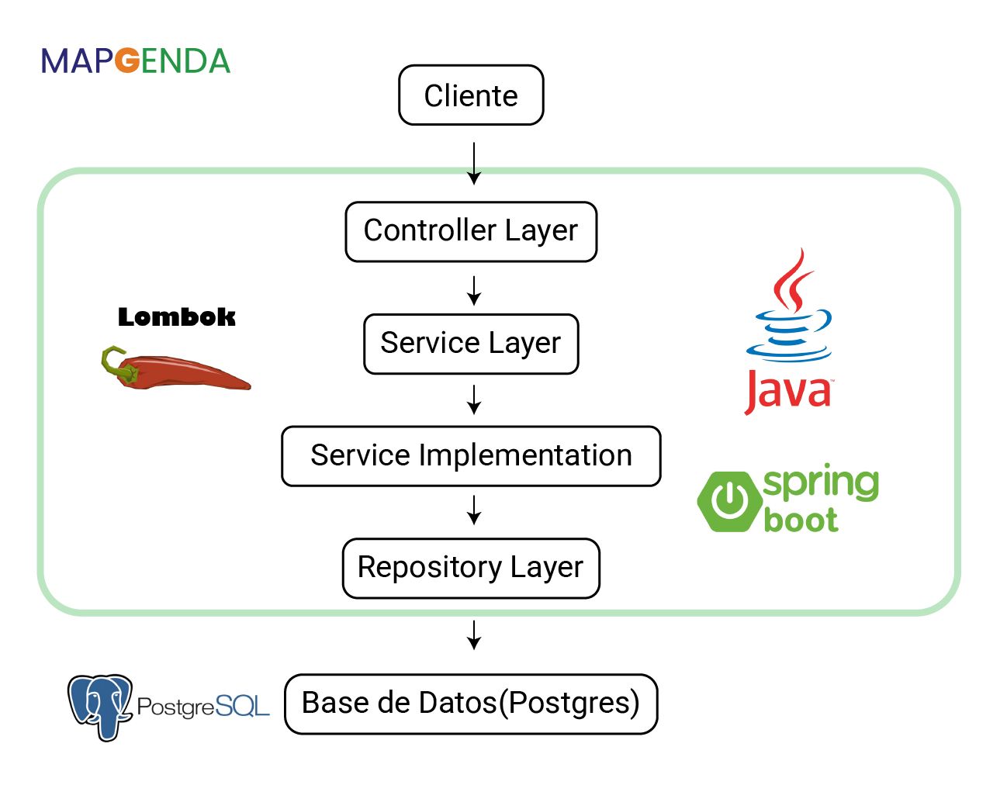
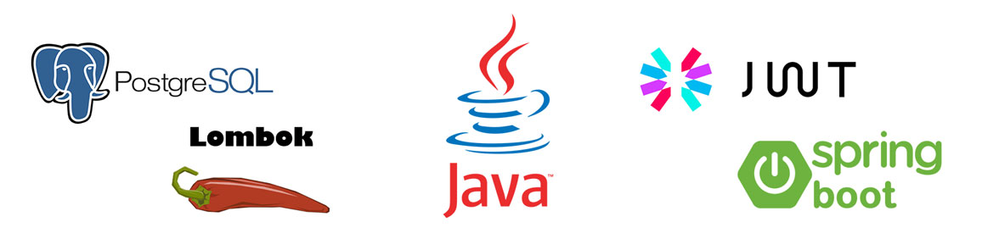
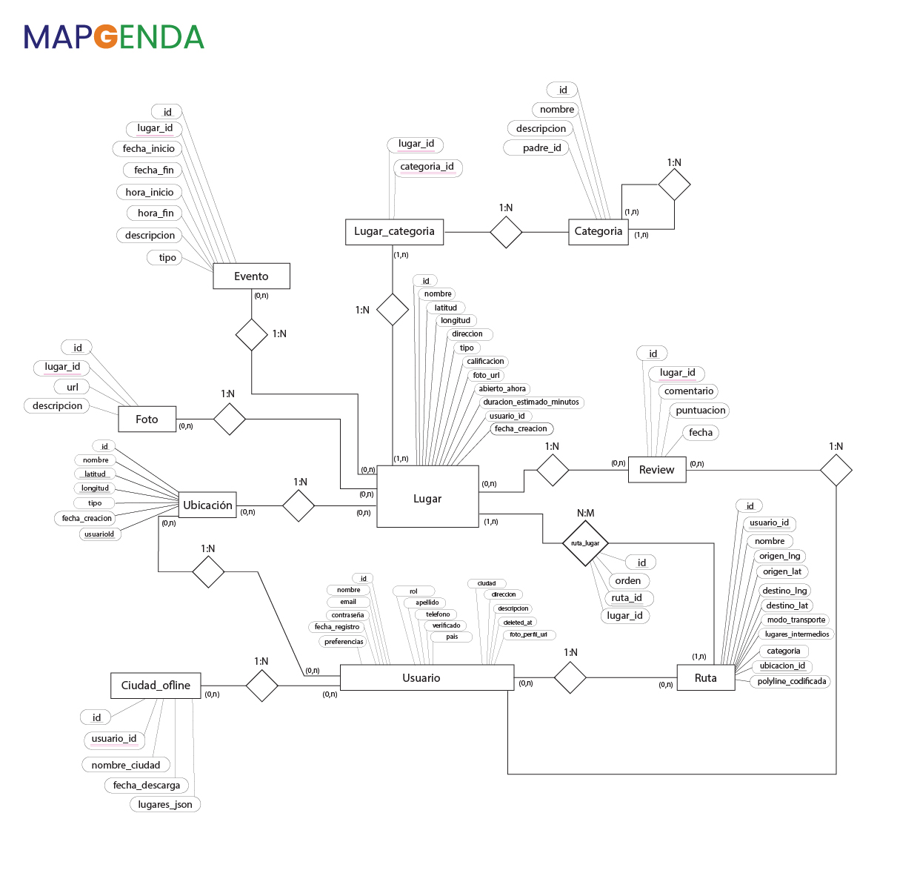

# 🛠️ Mapgenda Backend

API REST desarrollada en Java con Spring Boot, diseñada para servir como backend de la aplicación móvil **Mapgenda**. Se encarga de la autenticación de usuarios, el almacenamiento en la nube, la gestión de contenidos multimedia y la sincronización de datos entre el cliente móvil y servicios de terceros como **Google Sign-In** y **Cloudinary**.

---

## 🌐 Arquitectura General



---

## ✨ Funcionalidades Principales

- Registro y autenticación con **Google Sign-In**
- Gestión de sesiones con **JWT**
- Almacenamiento y carga de contenido multimedia vía **Cloudinary**
- Persistencia de datos con PostgreSQL + JPA
- API RESTful para la sincronización con la app móvil
- Seguridad con **Spring Security**

---

## ⚙️ Stack Tecnológico

| Componente          | Tecnología                      |
|---------------------|---------------------------------|
| **Framework**       | Spring Boot 3.4.4               |
| **Lenguaje**        | Java 21                         |
| **Build Tool**      | Maven                           |
| **Base de Datos**   | PostgreSQL + Spring Data JPA    |
| **Seguridad**       | Spring Security + JWT           |
| **Autenticación**   | Google Sign-In API              |
| **DTO ↔ Entidades** | MapStruct                       |
| **Boilerplate**     | Lombok                          |
| **JSON Mapper**     | Jackson                         |

---

## 🖼️ Visual Tech Stack



---

## 🚀 Instalación y Ejecución

### 🔧 Requisitos Previos

- JDK 21
- PostgreSQL en ejecución, con las extensiones `pgcrypto` y `uuid-ossp` (el script las crea; hace falta un usuario con permisos para ello)
- Maven 3.8+

### 📥 1. Clonar el repositorio

```bash
git clone https://github.com/Yucsan/Mapgenda_Backend.git
cd Mapgenda_Backend
```

### 🗄️ 2. Crear la base de datos

```bash
createdb mapgenda
psql -d mapgenda -f mapgenda_db/mapgenda_db.sql
```

### 🔑 3. Configurar credenciales

Configura la conexión a PostgreSQL, el secreto de JWT y las claves de Google y Cloudinary [indica aquí dónde: `application.properties` o variables de entorno]. No subas claves reales al repositorio.

### ▶️ 4. Ejecutar

```bash
mvn spring-boot:run
```

---

## 🗄️ Diseño de la Base de Datos

El esquema se encuentra en la carpeta [`mapgenda_db`](mapgenda_db/mapgenda_db.sql).



Al diseñar el esquema, uno de los retos clave fue darle **escalabilidad geográfica** a la aplicación. En principio la app estaba pensada para funcionar en una sola ciudad, como Sevilla, pero quería que pudiera operar en **cualquier lugar del mundo**.

Me di cuenta de que los *lugares* por sí solos no bastaban para construir búsquedas eficientes ni organizar rutas globales. Necesitaba una **capa adicional** que agrupara esos lugares y permitiera consultas por zona. Así nació la entidad **Ubicación**.

Podría parecer que una "ubicación" es lo mismo que un "lugar", pero son conceptos distintos: una **Ubicación** agrupa **múltiples lugares en una misma zona geográfica** (actualmente país o provincia). Esto permite **filtros espaciales**, cachear datos offline de regiones enteras y escalar la app a otros países.

Esta separación también aporta **flexibilidad**: los lugares se mantienen tal como llegan de Google Places, mientras que las ubicaciones definen los ámbitos de descarga, búsqueda y navegación, **sin duplicar información ni comprometer el modelo**. El resultado es una arquitectura pensada para **crecer geográficamente sin rehacer el diseño base**.

---

## 👤 Usuario administrador

Para entrar en la interfaz, crea tu propio usuario administrador. La contraseña se guarda cifrada con BCrypt: genera primero el hash de la contraseña que elijas (por ejemplo con `BCryptPasswordEncoder` de Spring Security o una herramienta de BCrypt) y sustitúyelo en el script:

```sql
-- Crear usuario con rol ADMIN
INSERT INTO public.usuario (
    id, nombre, apellido, email, contrasena, fecha_registro, rol, verificado
) VALUES (
    uuid_generate_v4(),
    'Admin',
    'Principal',
    'admin@example.com',
    '<HASH_BCRYPT_DE_TU_CONTRASEÑA>',
    CURRENT_TIMESTAMP,
    'ADMIN',
    true
);
```
